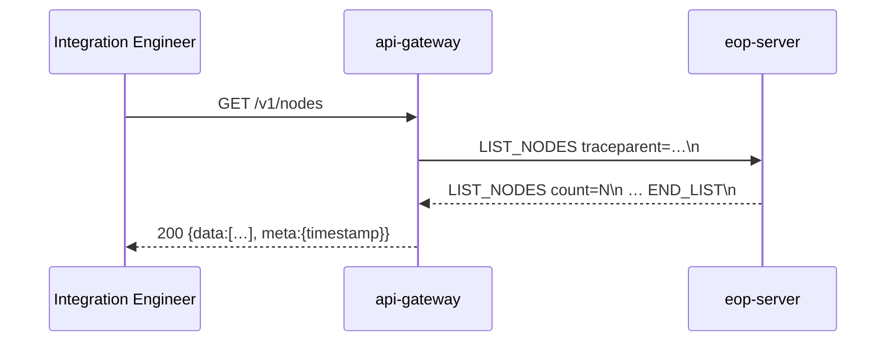
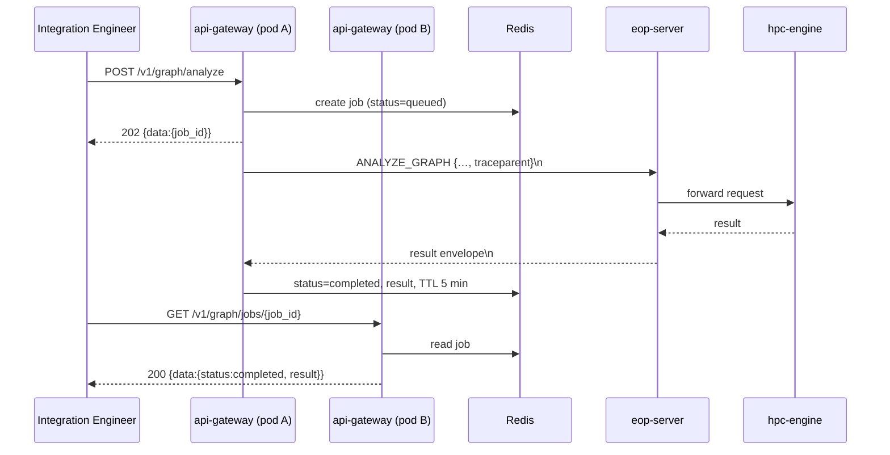

# ADR-010: API Gateway — Go, REST Contract and Async Job Store

**Status:** Accepted (v0.3, issue #50). Implemented by US-301 (#51) and US-302 (#52).

## Context and Problem

v0.3 exposes EOP to external consumers through a versioned REST API (US-301, US-302). Integration
Engineers must be able to list nodes and run graph analysis without knowing the internal socket
protocol. The component sits between the outside world and the C++ services of v0.1/v0.2, and it
has to:

* talk to `eop-server` over the existing TCP protocol (US-301 AC6, US-302 AC4) — no direct
  connection to `hpc-engine` and no reimplementation of business logic;
* serve a documented contract (OpenAPI 3.0, US-301 AC4) under a version prefix (US-301 AC5);
* answer large graph analyses asynchronously (`202` + polling, US-302 AC2) and keep results for at
  least 5 minutes (US-302 AC5);
* run as several replicas at once, because v0.3 also requires canary and blue-green deployments of
  this same component (US-304, US-305 — see ADR-011).

The PRD reference index fixes the language (ADR-010: Go). This ADR records that choice and the
design decisions it leaves open.

### Facts about the existing protocol that shape the client

The v0.1 protocol is hybrid, not pure JSON (see ADR-003 and `docs/analyze-graph-protocol-v0.2.md`):

| Command | Request | Response |
|---|---|---|
| greeting | — (sent by the server on connect) | `WELCOME Server v1.0 \| TIME … \| SESSION_ID …` |
| `QUERY_NODE` | `QUERY_NODE node_id=<id>` | `node_id=… bunker_name=… ip_address=… capacity=… status=… last_seen=<epoch>` or `ERROR_NOT_FOUND node_id=… desc=…` |
| `LIST_NODES` | `LIST_NODES` | `LIST_NODES count=N`, N record lines, `END_LIST` |
| `ANALYZE_GRAPH` | one-line JSON envelope | one-line JSON envelope (result or `ERROR_*`) |

Every message ends with `\n`. Commands do not require the connection to be registered as a node.
The server closes idle connections after `EOP_IDLE_TIMEOUT` (30 s in `k8s/configmap.yaml`), accepts
at most `EOP_MAX_CLIENTS` (100) connections, and serializes `ANALYZE_GRAPH` requests to a single
engine.

## Decision

### 1. Language and module layout

The gateway is written in Go, as one Go module shared with the v1.0 edge-ingestor (US-404), which
also has to speak the EOP protocol:

```text
services/go/
├── go.mod
├── cmd/api-gateway/        # this ADR
├── cmd/edge-ingestor/      # v1.0 (US-404), not created yet
├── internal/eopclient/     # EOP TCP protocol client — shared by both binaries
├── internal/api/           # HTTP handlers, envelope, error mapping
├── internal/jobs/          # async job store (Redis)
├── internal/config/        # environment + mounted ConfigMap
├── internal/telemetry/     # OTel traces/metrics, JSON logger
└── api/openapi.yaml        # the contract
```

Routing uses `go-chi/chi` (standard `net/http` handlers, no framework lock-in). There is no CGO and
no gRPC: a `net.Conn` is a TCP client of the same protocol the C client library uses.

### 2. EOP protocol client (`internal/eopclient`)

* Reads and discards the `WELCOME` banner on connect.
* Frames by `\n`; parses `key=value` lines and the `LIST_NODES … END_LIST` block; passes
  `ANALYZE_GRAPH` envelopes through as JSON.
* Uses a small connection pool. A connection is discarded after an error and is never kept idle
  longer than the server's idle timeout (configurable, default 20 s against the server's 30 s), so
  the gateway never writes to a socket the server already closed. Pool size is bounded well below
  `EOP_MAX_CLIENTS`, so the gateway cannot starve other clients.
* Every call has a deadline. Retries are limited to idempotent commands (`QUERY_NODE`,
  `LIST_NODES`) and to failures before the request was written; `ANALYZE_GRAPH` is never retried
  automatically, because it is expensive and the engine is a single serialized resource.
* Propagates the trace context: `traceparent` inside the `ANALYZE_GRAPH` envelope, as v0.2 already
  defines, and an optional `traceparent=` key on text commands (additive extension, decided in
  ADR-026).

### 3. REST contract

* All routes live under `/v1/`. A breaking change (removing or renaming a field, changing a type or
  a status code) requires `/v2/`, served side by side with `/v1/` until consumers migrate. Adding
  optional fields or new endpoints is not breaking.
* Successful responses use the envelope `{ "data": …, "meta": { "timestamp": … } }`
  (US-301 AC3). Errors use `{ "error": { "code": …, "message": …, "field": … }, "meta": … }`;
  `field` is present on validation errors (US-302 AC7).
* Internal errors are never forwarded verbatim. `ERROR_SERVICE_UNAVAILABLE` and `ERROR_HPC_TIMEOUT`
  become `503` with a generic message (US-302 AC3); `ERROR_NOT_FOUND` becomes `404`;
  `ERROR_INVALID_REQUEST`, `ERROR_INVALID_GRAPH`, `ERROR_UNSUPPORTED_ALGORITHM` and
  `ERROR_GRAPH_TOO_LARGE` become `400`/`413` with the protocol code kept in `error.code`.
* `GET /v1/health` checks the dependencies the gateway needs to serve traffic (a pooled connection
  to `eop-server` and Redis) and is the readiness probe (US-301 AC7). Liveness only checks that the
  process answers, so a downstream outage does not restart healthy gateway pods.

### 4. OpenAPI: hand-written spec, validated in CI

`api/openapi.yaml` is written by hand and embedded in the binary; `GET /v1/openapi.json` serves it
converted to JSON. CI lints the spec and a contract test checks that every registered route appears
in it. The fallback responses of the circuit breaker (ADR-012) are part of the spec.

### 5. Async jobs stored in Redis

Analyses of graphs with fewer than 1,000 nodes are answered synchronously within 5 s (US-302 AC1).
Larger graphs create a job: `POST` returns `202 Accepted` with `job_id`, a bounded worker pool runs
the request, and `GET /v1/graph/jobs/{job_id}` returns the state and, when finished, the result.

Jobs are stored in Redis, not in gateway memory. Each job is a hash with status and timestamps,
plus the result; a sorted set indexes recent jobs for `GET /v1/graph/jobs` (US-302 AC6). When a job
finishes its keys get a TTL of 5 minutes (US-302 AC5, configurable). Redis runs with a `maxmemory`
limit and the `volatile-ttl` eviction policy, so finished jobs are the first to go under pressure.
The gateway caps request bodies (configurable, default 32 MiB, below the server's 64 MiB framing
cap).

### 6. Service level objectives of the gateway

v0.3 adds an NFR of its own — REST API P99 latency < 300 ms — and US-304 AC4 rolls the canary back
on an error rate threshold, so both indicators have to be defined before they are measured.

| SLI | Definition | Objective |
|---|---|---|
| Latency | P99 of request duration measured in the gateway, for every route except `POST /v1/graph/analyze` | < 300 ms over 5 min |
| Error rate | `5xx` responses / all responses, per `version` and `track` | < 1 % over 5 min (canary rollback trigger) |
| Availability | non-`5xx` responses / all responses | ≥ 99.9 % over 30 days |

* **Measured in the gateway**, with an HTTP duration histogram and a response counter labeled by
  route, status class, `version` and `track`/`slot`. That is the only place where every request is
  attributed to the version that served it, which US-304 AC3 needs; ingress-nginx metrics are not
  enabled on minikube by default and would add a scrape target for the same data.
* **`POST /v1/graph/analyze` is outside the latency SLI.** Its synchronous path is allowed up to
  5 s by US-302 AC1 and its asynchronous path answers `202` immediately; it is tracked against the
  5 s bound instead, so a slow analysis cannot hide a regression in the node endpoints.
* **What counts as an error:** every `5xx`, including the `503` returned when a circuit is open
  and there is no cached value (ADR-012) — from the client's side the request failed. `4xx` are
  caller errors and do not count; a stale `200` served from the circuit breaker cache does not
  count either.
* **Error budget:** the availability objective uses the same 30-day window and the same budget
  thresholds as the server SLO (ADR-009), on its own panel of the SLO dashboard.

## Alternatives Considered

| Alternative | Reason rejected |
|---|---|
| **C++ gateway** (Crow, Drogon, Beast) | Higher setup cost for HTTP/OpenAPI, explicit thread management, and misses the multi-language objective of the PRD (PRD ADR-010). |
| **Gin or Echo instead of chi** | Both work; chi keeps plain `net/http` handlers, which makes handlers testable with `httptest` and keeps the dependency surface small. |
| **OpenAPI generated from annotations** (swaggo) | Comments drift silently and the generated spec is only as good as the annotations; a hand-written spec plus a route-coverage test fails loudly instead. |
| **Jobs in gateway memory** | With canary (stable + canary) and blue-green (blue + green) at least two gateway pods serve traffic at once. A `POST` can land on one pod and the poll on another, which answers `404` for a job that exists. A pod restart also loses every running job. |
| **Jobs in memory + sticky sessions** | Session affinity interferes with the weight-based split that US-304 measures, and still loses jobs on restart. |
| **Jobs stored in `eop-server`** | Requires a new protocol message for job state and turns the C++ server into a job scheduler, which is not its responsibility (ADR-004) and would be a breaking change after Proto Freeze. |
| **PostgreSQL or another database** | Durable storage is not needed: results only have to live 5 minutes. A heavier dependency for no requirement. |

## Justification (Trade-off Analysis)

* **Redis adds one component**, with its own deployment and failure mode. In exchange every gateway
  replica sees the same jobs, which is a precondition for US-304/US-305, and expiry (AC5) is a
  native TTL rather than code. If Redis is down, `/v1/health` reports not ready and async analysis
  returns `503`; node endpoints keep working.
* **The same Redis is reused in v1.0**: the edge-ingestor needs deduplication by `message_id`
  (US-404), which is a keyed set with TTL — the same primitive.
* **Sharing `internal/eopclient`** means the protocol is implemented once in Go and tested once;
  the edge-ingestor only adds its MQTT side.
* **A pool with short idle eviction** costs an occasional reconnect, which is cheap on a cluster
  network, and avoids the failure mode where the first request after a quiet period hits a
  connection the server already closed.

## Sequence Diagrams

### `GET /v1/nodes`



### Async graph analysis (≥ 1,000 nodes)



## Consequences

* **Positive:** Integration Engineers get a documented, versioned API; the protocol client is ready
  for v1.0; the gateway is stateless, so replicas, canary and blue-green work without special
  routing.
* **Negative:** One more stateful component (Redis) to deploy, observe and fit into the 7 GB
  development profile. Two encodings (text and JSON) must be maintained in the client until the
  protocol is unified.
* **Follow-ups:** the gateway gets its own Dockerfile (≤ 50 MB), Kubernetes manifests, CI job
  (vet, lint, race detector, coverage ≥ 90 %) and an entry in `docker-compose.yml`.

## References

* PRD — Milestone 3, US-301 and US-302; reference ADR-010 (API Gateway Language — Go).
* `ADR-003-message-protocol-design.md`, `docs/analyze-graph-protocol-v0.2.md` — the protocol the
  client implements.
* `ADR-004-service-boundaries.md` — why job scheduling does not belong in `eop-server`.
* `ADR-011-deployment-strategy-canary-blue-green.md` — why the gateway must be stateless.
* `ADR-012-circuit-breaker-configuration.md` — fallback responses in the contract.
* `ADR-026-centralized-logging-loki.md` — `traceparent=` on text commands.
