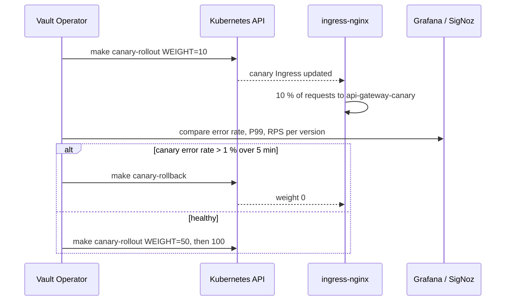
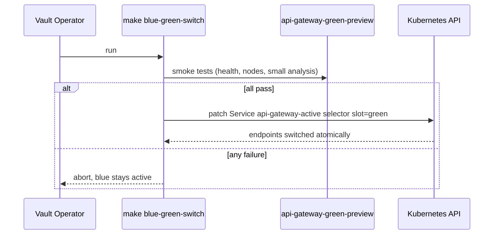

# ADR-011: Deployment Strategy — Canary and Blue-Green for the API Gateway

**Status:** Accepted (v0.3, issue #50). Implemented by US-304 (#55) and US-305 (#56).

## Context and Problem

EOP must keep ≥ 99.9 % availability (NFR), and a plain `kubectl set image` has a window in which
some requests fail. v0.3 requires two delivery patterns for the `api-gateway`, both executed live
in the demo with a continuous load test and zero client errors:

* **Canary** (US-304): stable (v1) and canary (v2) run side by side; an nginx Ingress sends a
  weighted share of traffic to the canary (10 % → 50 % → 100 %); SigNoz shows error rate, P99 and
  RPS per version; rollback sets the weight to 0 in < 30 s; `make canary-rollout WEIGHT=N` and
  `make canary-rollback` automate it.
* **Blue-green** (US-305): two complete Deployments; the Service selector points to blue; smoke
  tests run against green and, only if they pass, the selector switches atomically; rollback uses
  the same mechanism in < 10 s; `make blue-green-switch` automates it.

The PRD reference ADR-011 chooses both patterns and when to use each. This ADR records how they are
built on this cluster, and resolves one tension in the requirements.

### The tension in US-304 AC7

US-304 AC7 says *"Both Deployments share the same K8s Service. Only the Ingress weight changes to
shift traffic."* The ingress-nginx canary mechanism works with **two Ingress objects on the same
host, each pointing to a different backend Service**: the main Ingress sends traffic to one
Service and the canary Ingress (`nginx.ingress.kubernetes.io/canary: "true"`) diverts a weighted
share to another. If both Ingresses pointed to one Service that selects both Deployments, the main
Ingress would already spread traffic over v1 and v2 pods, and the weight would no longer mean
"percentage of traffic on v2" — AC2 and AC3 could not be measured.

## Decision

### 1. Labels

Every gateway pod carries `app: api-gateway` and `version: <semver>`. The canary layout adds
`track: stable|canary`; the blue-green layout adds `slot: blue|green`. The OTel resource
attributes `service.version` and `deployment.track` (or `deployment.slot`) carry the same values,
so SigNoz and Prometheus split error rate, P99 and RPS by version (US-304 AC3).

### 2. Canary layout

```text
                          ┌─ Ingress api-gateway        ──► Service api-gateway-stable ──► Deployment api-gateway-stable (v1)
host: api.eop.local ──────┤
                          └─ Ingress api-gateway-canary ──► Service api-gateway-canary ──► Deployment api-gateway-canary (v2)
                              canary-weight: "10"

Service api-gateway (selector app=api-gateway) ── both Deployments: in-cluster clients, smoke tests
```

* AC7 is met in the sense that matters for traffic shifting: both Deployments are members of the
  shared Service `api-gateway`, and during a rollout **the only object that changes is the
  `canary-weight` annotation**. Two thin per-track Services exist only because ingress-nginx needs
  distinct backends to apply a weight; they are created once and never edited.
* `make canary-rollout WEIGHT=N` runs `kubectl annotate --overwrite` on the canary Ingress.
  `make canary-rollback` sets the weight to 0; ingress-nginx applies weight changes dynamically,
  without reloading nginx, so the rollback is bounded by the API call and controller sync (seconds,
  well under the 30 s limit; the demo measures it).
* Rollback trigger (US-304 AC4): canary error rate > 1 % over 5 minutes, visible on the per-version
  panel. The procedure is documented in the runbook and is one command.
* Promotion after 100 %: the stable Deployment is updated to v2 (rolling update behind the
  readiness probe), then the weight returns to 0 and the canary Deployment scales to 0.

### 3. Blue-green layout

```text
Ingress api-gateway ──► Service api-gateway-active (selector app=api-gateway, slot=blue) ──► Deployment api-gateway-blue
                                                    patch selector slot=green ──────────────► Deployment api-gateway-green
Service api-gateway-green-preview (slot=green) ── smoke tests before the switch
```

* `make blue-green-switch` runs the smoke suite in `tests/smoke/` (health, node listing, one small
  graph analysis — US-305 AC6) against `api-gateway-green-preview`. Only if every test passes it
  runs a single `kubectl patch` on the selector of `api-gateway-active`; a Service update is atomic,
  so the endpoint list changes in one step (US-305 AC2, AC3, AC7).
* Rollback patches the selector back to `slot=blue`; both Deployments stay up, so no pod has to
  start (< 10 s, US-305 AC5).

### 4. Which layout is deployed when

Both layouts are Kustomize overlays of one base (`k8s/api-gateway/base`): `overlays/canary` and
`overlays/blue-green`. Only one is applied at a time, because they define the same Ingress host.
The steady state is the canary overlay with the canary Deployment scaled to 0 and weight 0. The
blue-green demo applies its overlay first; the move between overlays is not part of either
zero-downtime claim and is done before the load test starts.

### 5. What makes "zero client errors" hold

* Readiness probe on `GET /v1/health`; a pod gets traffic only when it can reach `eop-server` and
  Redis.
* `preStop` sleep (5 s) followed by graceful shutdown on SIGTERM (`http.Server.Shutdown`, exit
  code 0): the endpoint is removed from ingress-nginx before the process stops accepting
  connections, and in-flight requests finish.
* Rolling updates with `maxUnavailable: 0`, `maxSurge: 1`.
* In blue-green, the old slot is not scaled down until the switch is verified.
* A continuous load script (`tests/load/`) runs through every weight change and switch, and fails
  if it sees any 5xx or connection error (US-304 AC6, US-305 AC4).

## When to Use Each

| Situation | Pattern |
|---|---|
| Behavior under real load is uncertain (new dependency, performance change) | Canary |
| Change is fully covered by tests and smoke tests | Blue-green |
| Rollback speed is the main concern | Blue-green |
| Running two full environments is too expensive | Canary |

## Alternatives Considered

| Alternative | Reason rejected |
|---|---|
| **One Service for both canary tracks, weight via replica count** | The split follows pod count, not a percentage: 10 % needs 1 canary pod per 9 stable pods. Not adjustable "without redeploying" (US-304 AC2). |
| **Service mesh (Istio, Linkerd) traffic splitting** | Exact weights per Service, but a whole control plane does not fit the 7 GB development cluster and is outside v1.0 scope (mTLS between services is explicitly out). |
| **Argo Rollouts / Flagger** | Automates analysis and promotion, but the PRD asks for the progression to be executed manually with dashboards visible, and adds CRDs and a controller. |
| **Blue-green by switching the Ingress backend** | Also works, but an Ingress change goes through the controller's reconciliation; a Service selector patch is the mechanism the PRD names and is atomic at the Service level. |

## Justification (Trade-off Analysis)

* **Two extra Services** are the price of exact, observable weights with plain ingress-nginx. They
  never change during a rollout, so they do not add steps or risk to the procedure.
* **Two overlays instead of one combined layout** keep each demo exactly as the PRD describes it
  (named Deployments, one Service selector, one weight annotation). A combined layout (two slots
  that act as stable/canary or blue/green depending on the operation) needs fewer objects but
  renames the Deployments the acceptance criteria name.
* **The gateway being stateless** (ADR-010: jobs in Redis) is what lets requests of one client move
  between versions mid-flight without errors.

## Sequence Diagrams

### Canary progression and rollback



### Blue-green switch



## Consequences

* **Positive:** both patterns run on stock ingress-nginx and are demonstrable on minikube
  (`minikube addons enable ingress`); every rollout step is one versioned `make` target.
* **Negative:** more Kubernetes objects for one component (two Deployments, three Services and up
  to two Ingresses per overlay); moving between overlays is a manual, non-zero-downtime step that
  must be done outside the demo window.
* **Follow-ups:** a per-version panel (error rate, P99, RPS) in Grafana, the runbook sections for
  rollback, and the measured rollback and switch times recorded as evidence.

## References

* PRD — Milestone 3, US-304 and US-305; reference ADR-011 (Deployment Strategy — Canary and
  Blue-Green).
* `ADR-010-api-gateway-go.md` — stateless gateway and Redis job store.
* `ADR-017-kubernetes-workload-management.md` — probes and resource limits already used by the
  C++ services.
* ingress-nginx documentation — canary annotations.
