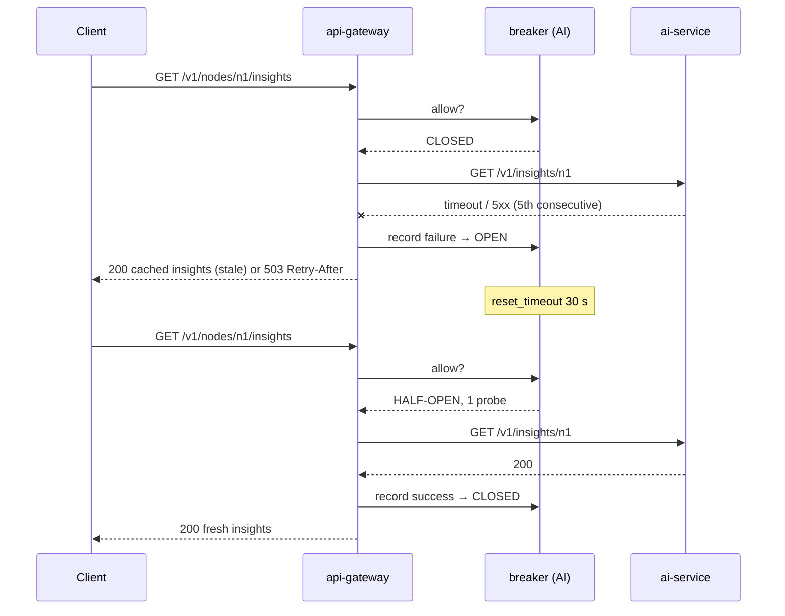

# ADR-012: Circuit Breaker Configuration for External Services

**Status:** Accepted (v0.3, issue #50). Implemented by US-303 (#53).

## Context and Problem

The PRD places two external services behind the gateway: an AI service (Python) and a corporate
service (Spring Boot), owned by Vault-Tec. A slow or failing external service must not cascade
into EOP: without protection, requests that depend on it pile up, hold goroutines and connections,
and eventually exhaust the gateway (US-303).

US-303 and the PRD reference ADR-012 fix the behavior:

* one circuit breaker per external service (AC1);
* opens after **5 consecutive failures** or an **error rate > 50 % in a 10 s window** (AC2);
* while open, a predefined fallback is served — cached data or a degraded response — never a `500`
  (AC3);
* after **30 s** it goes HALF-OPEN; one successful probe closes it (AC4);
* state exposed in Prometheus and in the Grafana SLO dashboard (AC5); fallback documented in
  OpenAPI (AC6); thresholds in a ConfigMap, changeable without redeploying (AC8);
* demonstrated end to end: service down → open → fallback → service up → closed (AC7).

**Neither external service exists in this project.** They are provided by Vault-Tec in the
scenario, but no implementation or contract was handed to the squad, so this ADR also decides how
they are represented.

## Decision

### 1. External services are represented by one configurable stub

A single small Go binary, `services/go/cmd/external-stub`, runs as two Deployments: `ai-service`
and `corporate-service`, selected by configuration. Each exposes `GET /health` and one business
endpoint:

| Service | Endpoint | Used by gateway route |
|---|---|---|
| AI | `GET /v1/insights/{node_id}` → risk score and recommendation | `GET /v1/nodes/{node_id}/insights` |
| Corporate | `GET /v1/bunkers/{bunker_name}/status` → supply quota and compliance flag | `GET /v1/nodes/{node_id}/corporate` |

Failure is injected by configuration or at runtime (`POST /admin/fault` with `ok`, `error` or
`slow`), and "stopping the service" in the demo is `kubectl scale --replicas=0`, exactly as the PRD
describes it. The stubs are test doubles: their language does not change the contract the gateway
sees (HTTP + JSON), and they are excluded from EOP's business-logic coverage.

### 2. Own implementation of the breaker, with a sliding window

The breaker lives in `services/go/internal/breaker` (about 200 lines) instead of a library:

* **States:** CLOSED → OPEN → HALF-OPEN → CLOSED, as in the PRD state machine.
* **Trip conditions (either):** `failure_threshold` consecutive failures; or, over a sliding
  `window_duration` made of 1 s buckets, error rate > `error_rate_threshold` **with at least
  `min_requests` calls in the window**.
* **Recovery:** after `reset_timeout` in OPEN it allows `half_open_max_calls` probes; success
  closes, failure reopens and restarts the timer.
* **What counts as a failure:** connection error, timeout (`call_timeout` per call) or `5xx` from the
  external service. `4xx` is a caller error and does not count.
* **No automatic retries** towards external services: retries amplify load on a failing service
  (PRD ADR-012, alternatives).
* A clock interface makes every transition testable without sleeping.

### 3. Configuration

Externalized in the `api-gateway-breaker` ConfigMap, mounted as a file (not as environment
variables, which only change on restart). The gateway re-reads the file when it changes and applies
the new values to the existing breakers without resetting their state.

| Parameter | Default | Source |
|---|---|---|
| `failure_threshold` | 5 | US-303 AC2 |
| `error_rate_threshold` | 0.5 | US-303 AC2 |
| `window_duration` | 10 s | US-303 AC2 |
| `min_requests` | 10 | this ADR (see justification) |
| `reset_timeout` | 30 s | US-303 AC4 |
| `half_open_max_calls` | 1 | PRD ADR-012 |
| `call_timeout` | 2 s | this ADR |

A mounted ConfigMap reaches the pod after the kubelet sync period (up to about a minute); no
restart or redeploy is needed (AC8).

### 4. Fallbacks

| Service | Fallback while OPEN |
|---|---|
| AI insights | Last successful response for that node, with `meta.stale: true` and `meta.stale_since`. If there is none: `503` with `Retry-After` and `error.code: "SERVICE_DEGRADED"`. |
| Corporate status | Same rule: cached response marked stale, else `503` + `Retry-After`. |

The node data itself (`/v1/nodes/{node_id}`) never depends on external services, so the core API
keeps working with both circuits open. The cache is a bounded in-memory LRU per pod: a stale value
is an optimization, and its absence still yields a valid, documented response. Both fallback shapes
are part of `api/openapi.yaml` (AC6).

### 5. Observability

* Gauge `eop_gateway_circuit_state{service}` (0 closed, 1 half-open, 2 open) → Grafana panel in the
  SLO dashboard, covered by its dashboard contract test (AC5).
* Counter `eop_circuit_breaker_state_transitions_total{service,from_state,to_state}` (name from PRD
  ADR-012).
* Counter `eop_gateway_fallback_responses_total{service,kind}` (`stale` or `degraded`).
* OTel span event `circuit_breaker.state_change` on the request span that caused the transition.
* One structured log line per transition, with `trace_id`.

## Alternatives Considered

| Alternative | Reason rejected |
|---|---|
| **`sony/gobreaker`** | Mature and small, but its counts reset on a fixed interval (a tumbling window, not the sliding 10 s window of AC2), its settings are fixed at construction (hot reload would mean recreating breakers and losing their state), and transition hooks would still be needed for the PRD's metrics and span events. |
| **`failsafe-go` or similar** | Supports time-based thresholds, but brings a general resilience framework for one pattern; the same metric and reload glue would still be written. |
| **Timeouts only / retries with backoff only / immediate 503** | Rejected in the PRD reference ADR-012: timeouts keep hitting the failing service, retries amplify the failure, immediate 503 never recovers and gives no degraded data. |
| **Real Python and Spring Boot services** | They are Vault-Tec's, not EOP's. Building them adds two stacks (a Spring Boot image is far above the 50 MB limit) without testing anything the gateway does differently. |
| **Python stub for the AI service** | Matches the scenario's language, but a minimal Python image is close to or above the 50 MB limit, and the gateway cannot tell the difference over HTTP. |

## Justification (Trade-off Analysis)

* **`min_requests`** prevents a single failed call in a quiet window (1 of 1 = 100 %) from opening
  the circuit. The consecutive-failure rule still opens it quickly under low traffic, so AC2 holds
  in both regimes. The value is configurable and is stated as this ADR's addition, not the PRD's.
* **Owning ~200 lines** costs tests that a library would not need, but gives exactly the PRD
  semantics, hot reload without state loss, and a component small enough to explain in the defense.
* **Per-pod breakers:** each gateway replica keeps its own state, so two pods may open at slightly
  different moments. Sharing state (in Redis) would couple every external call to Redis latency and
  availability; per-instance breakers are the standard trade-off.

## Sequence Diagram

## Consequences

* **Positive:** failures of external services degrade one optional piece of data instead of the
  gateway; every transition is visible in Prometheus, Grafana and SigNoz; the demo needs no special
  tooling beyond `kubectl scale`.
* **Negative:** the stub is a simplification of services the project does not control; the
  contracts (`/v1/insights`, `/v1/bunkers/…/status`) are the squad's assumption and would change if
  Vault-Tec published real ones.
* **Follow-ups:** the AC7 integration test drives the stub's fault endpoint; the runbook documents
  the demo steps.

## References

* PRD — Milestone 3, US-303; reference ADR-012 (Circuit Breaker Configuration).
* `ADR-010-api-gateway-go.md` — gateway structure and OpenAPI contract.
* `ADR-009-slo-definition-and-enforcement.md` — SLO dashboard that hosts the circuit panel.
