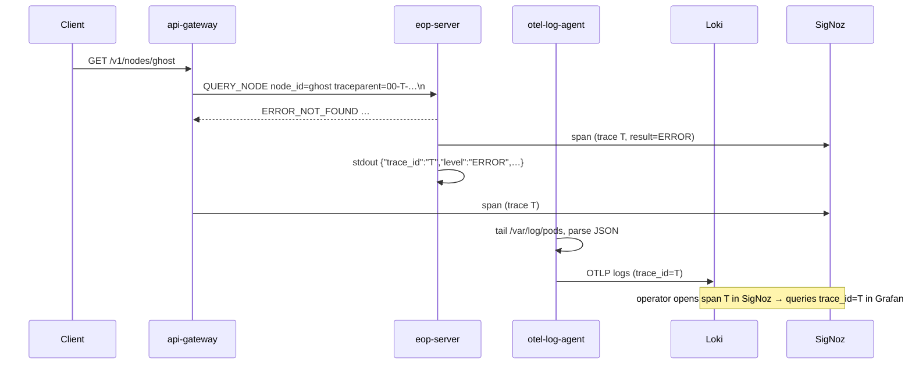

# ADR-026: Centralized Logging — Loki, OTel Collector Agent and Trace Correlation

**Status:** Accepted (v0.3, issue #50). Implemented by US-306 (#54).

## Context and Problem

Today a Vault Operator diagnoses a problem by running `kubectl logs` pod by pod. US-306 requires
one place to search the logs of every EOP service, filterable by service, level and `trace_id`, and
a way to go from a SigNoz span to the exact log lines of that request:

* Loki collects logs of all EOP pods; Grafana Explore filters by service, level and `trace_id`
  (AC1); collection is automatic for new pods (AC5);
* every log entry carries the `trace_id` of the OTel trace that produced it (AC2), and an operator
  can navigate from a span to its logs (AC3);
* ≥ 7 days retention, no loss on pod restarts (AC4), policy as code in
  `monitoring/loki/config.yaml` (AC8);
* an integration test proves a failed operation produces an ERROR span in SigNoz and an ERROR log
  in Loki with the same `trace_id` (AC6); a runbook section covers alert → logs (AC7).

Three gaps in the current code stand in the way:

1. **No `service` field in the C++ logs.** ADR-019 defines it in the log schema, but the logger
   (`lib/src/eventAuditLogger.cpp`) does not emit it.
2. **Text commands carry no trace context.** `traceparent` travels only inside the
   `ANALYZE_GRAPH` JSON envelope (ADR-015). A `QUERY_NODE` or `LIST_NODES` sent by the gateway
   starts a new trace in `eop-server`, so its log lines cannot be joined to the gateway's request.
3. **No log collector.** The OTel Collector of ADR-005 receives traces and metrics pushed by the
   services; nothing reads container output.

## Decision

### 1. Storage: Grafana Loki, single binary

Loki 3.x in single-binary mode (`k8s/loki/`), filesystem storage on a PersistentVolumeClaim, with
retention enforced by the compactor:

```yaml
# monitoring/loki/config.yaml (excerpt)
limits_config:
  retention_period: 168h        # 7 days (US-306 AC4)
compactor:
  retention_enabled: true
```

Grafana gets a Loki datasource next to Prometheus.

### 2. Collection: OpenTelemetry Collector as a node agent

A second OTel Collector (contrib distribution) runs as a **DaemonSet** (`otel-log-agent`) and
reads container log files under `/var/log/pods`:

* `filelog` receiver with the container parser, then a `json_parser` for EOP's structured lines;
* `trace_parser` maps the JSON `trace_id`/`span_id` into the log record's trace context, so Loki
  stores them as the record's trace ID, not as free text;
* `k8sattributes` adds pod, namespace and container; `service.name` comes from the JSON `service`
  field (or the pod's `app` label for third-party containers);
* export over OTLP to Loki's native OTLP endpoint (`/otlp`). `service.name` is an index label;
  `level`, `trace_id` and `node_id` are structured metadata, filterable in LogQL
  (`{service_name="eop-server"} | level="ERROR" | trace_id="…"`);
* file offsets are checkpointed with the `file_storage` extension on a `hostPath`, so restarting
  the agent neither loses nor duplicates lines. Lines of an application pod that restarts are
  already on the node's disk and are read before kubelet rotates them (AC4).

New pods are picked up by path, with no application change (AC5).

### 3. Correlation

* **Logs → traces:** a derived field on the Loki datasource turns `trace_id` into a link to the
  trace in SigNoz.
* **Traces → logs (AC3):** a Grafana dashboard "Request logs" takes `trace_id` as a variable;
  the runbook documents copying the trace ID from a SigNoz span into it (or into Explore). SigNoz
  cannot link to Grafana by itself, so this direction is a documented procedure, not a button.

### 4. Changes to EOP services

* **`eop-server`:** the logger emits `service` (from `OTEL_SERVICE_NAME`, default `eop-server`),
  closing the ADR-019 gap. If the course repository fixes this first (v0.1 corrections), the fix is
  taken from there when it is synced.
* **Protocol addendum (additive, non-breaking):** text commands may carry an optional
  `traceparent=<W3C traceparent>` key, as the last key of the line:
  `QUERY_NODE node_id=alpha-01 traceparent=00-…-…-01`. When it is present and valid the server
  starts the command span as its child; when it is absent or invalid the server behaves as today.
  Compatibility holds in both directions: the current server already ignores trailing keys
  (`sscanf` stops after the fields it expects and dispatch matches by command prefix), and clients
  that never send the key are unaffected. ADR-003 gets an addendum pointing here, in the same way
  ADR-015 extended it for `ANALYZE_GRAPH`.
* **`api-gateway`:** logs JSON with the same fields and sends `traceparent` on every command
  (ADR-010).

## Alternatives Considered

| Alternative | Reason rejected |
|---|---|
| **Promtail** | Reached end of life on 2 March 2026: no bug or security fixes. Starting a new pipeline on it is not defensible. |
| **Grafana Alloy** | Grafana's replacement for Promtail and itself an OpenTelemetry Collector distribution; a valid choice. Not chosen because the project already runs and configures the upstream OTel Collector (ADR-005, ADR-021), so the same configuration language and components cover logs too. |
| **Services push logs over OTLP (OTel logs SDK)** | Gives trace context for free, but changes the C++ logger and every service, and logs written before the exporter starts or during a crash are lost. Reading stdout keeps ADR-019's "logs go to stdout" contract and works for third-party containers. |
| **Elasticsearch / OpenSearch + Kibana** | Full-text indexing at a memory cost that does not fit the 7 GB development cluster; Loki indexes only labels. |
| **SigNoz logs (ClickHouse)** | SigNoz can store logs and would give span → logs in one UI, but US-306 asks for Loki and Grafana Explore explicitly, and ClickHouse is already the heaviest component of the cluster. |
| **New JSON envelope for text commands** | Would carry trace context cleanly but is a breaking protocol change after Proto Freeze. |

## Justification (Trade-off Analysis)

* **A DaemonSet agent** costs one collector per node (one node on minikube) and access to
  `/var/log/pods`, in exchange for zero application changes per new service.
* **OTLP into Loki** keeps `trace_id` as a first-class field instead of a regex over text, which is
  what makes AC2/AC6 checkable by query.
* **The `traceparent=` key** is the smallest change that makes one request one trace across
  gateway and server. Adding it as the last, optional key keeps every existing parser valid.
* **Single-binary Loki on a PVC** is enough for one cluster and seven days; it is not highly
  available, which is acceptable for v0.3 and noted for v1.0 sizing.

## Sequence Diagram



## Consequences

* **Positive:** one query surface for all services; logs and traces share IDs; retention is code;
  the protocol change is backwards compatible.
* **Negative:** two more components (Loki, log agent) in the development profile; the
  traces → logs direction is a procedure; a single Loki instance is a single point of failure for
  log search (not for the services).
* **Follow-ups:** ADR-003 addendum; C++ changes covered by unit tests and ASan/TSan; the AC6
  integration test; runbook section "From a Grafana alert to the request logs".

## References

* PRD — Milestone 3, US-306.
* `ADR-003-message-protocol-design.md`, `ADR-015-protocol-extension-and-trace-propagation.md` —
  protocol and existing trace propagation.
* `ADR-005-observability-strategy.md`, `ADR-021-unified-signoz-stack.md` — current OTel/SigNoz
  pipeline.
* `ADR-019-structured-json-logs.md` — log schema, including `service`.
* Grafana — Promtail end of life and migration to Alloy:
  https://grafana.com/docs/alloy/latest/set-up/migrate/from-promtail/
