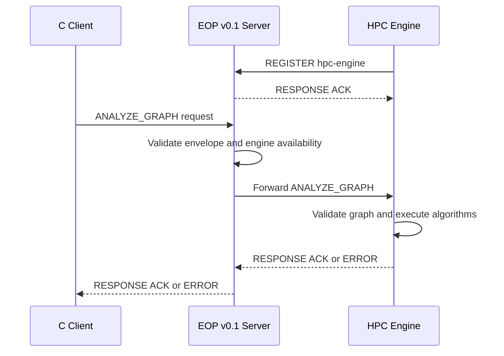

# ANALYZE_GRAPH Protocol Extension v0.2

## Overview

`ANALYZE_GRAPH` is the EOP v0.2 protocol extension used to request graph analysis through the existing EOP communication path.

This document defines the wire-level contract for the message exchange between:

```text
C client → EOP v0.1 server → HPC engine → EOP v0.1 server → C client
```

The document is intentionally limited to the protocol contract: message fields, request schema, response schema, error schema, validation rules, and component responsibilities.

Architectural decisions such as why the HPC engine is a standalone process, why OpenMP is used, how the graph is represented internally, and how the engine is deployed are documented in the corresponding v0.2 ADRs.

## Relationship with Existing ADRs

This protocol extension depends on the existing v0.1 protocol decision documented in `adr/ADR-003-message-protocol-design.md`.

The extension preserves the existing protocol rules:
- payload encoding remains JSON;
- message framing remains delimiter-based using `\n`;
- existing v0.1 message types remain unchanged;
- `ANALYZE_GRAPH` is additive and non-breaking.

The HPC integration pattern is defined in the v0.2 ADRs. This document only defines the message contract required to implement that integration.

## Transport and Framing

`ANALYZE_GRAPH` uses the same transport and framing mechanism as the existing EOP protocol.

- Transport: TCP socket.
- Encoding: JSON.
- Message delimiter: newline character `\n`.
- Each message must be sent as one complete JSON object followed by `\n`.

Example:

```json
{"type":"ANALYZE_GRAPH","request_id":"req-001","payload":{"nodes":["A"],"edges":[],"algorithms":["connected_components"]}}
```

The receiver must read until the newline delimiter before attempting to parse the JSON payload.

## Message Flow

The client does not communicate directly with the HPC engine.

The expected flow is:

1. The HPC engine starts and registers itself with the EOP server using the existing `REGISTER` message.
2. A C client sends an `ANALYZE_GRAPH` message to the EOP server.
3. The EOP server validates the message envelope and checks that an HPC engine is available.
4. The EOP server forwards the request to the registered HPC engine.
5. The HPC engine validates and processes the graph.
6. The HPC engine returns either an `ACK` response with results or an `ERROR` response.
7. The EOP server forwards the final response to the originating client.

## Request Schema

### Required Top-Level Fields

| Field | Type | Required | Description |
|---|---|---:|---|
| `type` | string | yes | Must be `ANALYZE_GRAPH`. |
| `request_id` | string | yes | Client-generated identifier used to correlate request and response. |
| `traceparent` | string | recommended | W3C trace context field used for distributed tracing. Since v0.3 the server continues this trace (ADR-026) when the field appears before `payload`. |
| `tracestate` | string | optional | Optional W3C trace state metadata. |
| `payload` | object | yes | Graph analysis request payload. |

### Required Payload Fields

| Field | Type | Required | Description |
|---|---|---:|---|
| `nodes` | array of strings | yes | List of graph node identifiers. |
| `edges` | array of objects | yes | List of graph edges. Can be empty for a single-node or disconnected graph. |
| `algorithms` | array of strings | yes | List of requested algorithms. |

### Edge Object Schema

| Field | Type | Required | Description |
|---|---|---:|---|
| `from` | string | yes | Source node identifier. Must exist in `nodes`. |
| `to` | string | yes | Target node identifier. Must exist in `nodes`. |
| `weight` | number | yes | Positive finite edge weight. |

### Supported Algorithms

The following algorithm names are valid:

| Algorithm | Description |
|---|---|
| `shortest_paths` | Shortest path analysis. Implemented by the HPC engine using Dijkstra or the chosen internal algorithm. |
| `connected_components` | Detection of connected components in the graph. |
| `centrality` | Centrality analysis to identify relevant or critical nodes. |

## Request Example

```json
{
  "type": "ANALYZE_GRAPH",
  "request_id": "req-2026-0001",
  "traceparent": "00-4bf92f3577b34da6a3ce929d0e0e4736-00f067aa0ba902b7-01",
  "tracestate": "eop=hpc",
  "payload": {
    "nodes": ["A", "B", "C"],
    "edges": [
      {
        "from": "A",
        "to": "B",
        "weight": 10
      },
      {
        "from": "B",
        "to": "C",
        "weight": 5
      }
    ],
    "algorithms": [
      "shortest_paths",
      "connected_components",
      "centrality"
    ]
  }
}
```

## Successful Response Schema

### Required Top-Level Fields

| Field | Type | Required | Description |
|---|---|---:|---|
| `type` | string | yes | Must be `RESPONSE`. |
| `status` | string | yes | Must be `ACK`. |
| `request_id` | string | yes | Must match the original request. |
| `traceparent` | string | recommended | Trace context associated with the response. |
| `result` | object | yes | Graph analysis result payload. |

### Optional Result Fields

| Field | Type | Description |
|---|---|---|
| `algorithm_metadata` | object | Per-algorithm notes on how a result was produced. Present only when an algorithm has something to declare, so responses with nothing to report keep their previous shape. Currently emitted by `centrality` when scores are estimated rather than computed exactly (see `adr/ADR-024-approximate-betweenness-centrality.md`). |

```json
"algorithm_metadata": {
  "centrality": {
    "approximate": true,
    "method": "brandes_pivot_sampling",
    "sampled_sources": 1024,
    "total_sources": 10000
  }
}
```

A consumer that treats `centrality` values as exact figures **must** check
`result.algorithm_metadata.centrality.approximate` first: above
`EOP_HPC_CENTRALITY_EXACT_MAX_NODES` nodes the scores carry a documented margin of error.

### Required Result Fields

| Field | Type | Required | Description |
|---|---|---:|---|
| `graph_size` | object | yes | Number of nodes and edges processed. |
| `processing_time_ms` | number | yes | Total wall-clock processing time in milliseconds. |
| `thread_count` | number | yes | Number of OpenMP threads available to the HPC engine during execution. |
| `executed_algorithms` | array of strings | yes | Ordered list of algorithm identifiers executed by the engine. |
| `algorithm_timings_ms` | object | yes | Wall-clock duration in milliseconds for each executed algorithm. |
| `algorithms` | object | yes | Results grouped by algorithm name. |

## Successful Response Example

```json
{
  "type": "RESPONSE",
  "status": "ACK",
  "request_id": "req-2026-0001",
  "traceparent": "00-4bf92f3577b34da6a3ce929d0e0e4736-3e0e7a4f6b2c1a9a-01",
  "result": {
    "graph_size": {
      "nodes": 3,
      "edges": 2
    },
    "processing_time_ms": 12,
    "thread_count": 4,
    "executed_algorithms": [
      "shortest_paths",
      "connected_components",
      "centrality"
    ],
    "algorithm_timings_ms": {
      "shortest_paths": 5.1,
      "connected_components": 1.8,
      "centrality": 5.1
    },
    "algorithms": {
      "shortest_paths": {
        "A-C": {
          "path": ["A", "B", "C"],
          "cost": 15
        }
      },
      "connected_components": [
        ["A", "B", "C"]
      ],
      "centrality": {
        "A": 0.0,
        "B": 1.0,
        "C": 0.0
      }
    }
  }
}
```

## Error Response Schema

All `ANALYZE_GRAPH` errors must use a structured response.

### Required Error Fields

| Field | Type | Required | Description |
|---|---|---:|---|
| `type` | string | yes | Must be `RESPONSE`. |
| `status` | string | yes | Must be `ERROR`. |
| `request_id` | string | recommended | Matches the original request if available. |
| `error_code` | string | yes | Machine-readable error code. |
| `message` | string | yes | Human-readable error description. |
| `field` | string | optional | Field that caused the error, when applicable. |
| `retryable` | boolean | optional | Indicates whether retrying the request may succeed. |

## Error Response Example

```json
{
  "type": "RESPONSE",
  "status": "ERROR",
  "request_id": "req-2026-0001",
  "error_code": "ERROR_INVALID_GRAPH",
  "message": "The graph contains an edge that references a node not present in the nodes list.",
  "field": "payload.edges[1].to",
  "retryable": false
}
```

## Error Codes

| Error Code | Applies When | Retryable |
|---|---|---:|
| `ERROR_INVALID_REQUEST` | Missing payload, invalid JSON structure, missing required fields, or invalid `request_id`. | false |
| `ERROR_INVALID_GRAPH` | Empty nodes list, duplicated nodes, invalid edge reference, invalid edge weight, or malformed graph structure. | false |
| `ERROR_UNSUPPORTED_ALGORITHM` | The request includes an algorithm not supported by v0.2. | false |
| `ERROR_GRAPH_TOO_LARGE` | The graph exceeds configured node or edge limits. | false |
| `ERROR_SERVICE_UNAVAILABLE` | No registered HPC engine is available. | true |
| `ERROR_HPC_TIMEOUT` | The HPC engine does not respond within the configured timeout. | true |
| `ERROR_ANALYSIS_FAILED` | The HPC engine fails while processing a valid graph. | true |

## Validation Rules

The EOP server and the HPC engine share validation responsibilities.

### Server-Side Validation

The EOP server must validate:

- the JSON message is well-formed;
- `type` is `ANALYZE_GRAPH`;
- `payload` exists;
- `request_id` exists when required by the implementation;
- an HPC engine is registered and available;
- the graph does not exceed configured size limits, if those limits are checked before dispatch;
- the engine response timeout is enforced.

The server must not block indefinitely while waiting for the HPC engine.

### HPC Engine Validation

The HPC engine must validate:

- `nodes` is present and is not empty;
- all node identifiers are strings;
- node identifiers are unique;
- `edges` is present and is an array;
- every edge has `from`, `to`, and `weight`;
- every edge references existing nodes;
- every weight is a positive finite number;
- every requested algorithm is supported;
- the graph can be converted to the engine internal representation.

If validation fails, the HPC engine must return a structured `ERROR` response.

## Size Limits

The protocol supports large graph payloads, but concrete limits must be configurable by implementation.

Recommended v0.2 configuration keys:

| Configuration | Description | hpc-engine default |
|---|---|---|
| `EOP_MAX_GRAPH_NODES` | Maximum number of nodes accepted in a request. | 100,000 |
| `EOP_MAX_GRAPH_EDGES` | Maximum number of edges accepted in a request. | 500,000 |
| `EOP_MAX_SHORTEST_PATHS_NODES` | Maximum nodes when `shortest_paths` is one of the requested algorithms — stricter than `EOP_MAX_GRAPH_NODES` on purpose. | 300 |
| `EOP_HPC_CENTRALITY_EXACT_MAX_NODES` | Node count up to which `centrality` is computed exactly. Above it, scores are estimated from sampled sources (ADR-024). | 10,000 |
| `EOP_HPC_CENTRALITY_SAMPLES` | Number of source nodes sampled when `centrality` is estimated. Higher is more accurate and slower. | 1,024 |
| `EOP_HPC_TIMEOUT_MS` | Maximum time the server waits for the HPC engine response. | — |
| `EOP_MAX_REQUEST_BYTES` | **eop-server**, not the engine: largest message it will buffer while waiting for the terminating `\n`. A guard against a client that never terminates a message, not a size policy — what a graph may contain is decided by the keys above, which answer with `ERROR_GRAPH_TOO_LARGE`. It must therefore stay above any request the engine accepts: at the defaults above a request serializes to roughly 25-30 MiB. | 64 MiB |

A message that exceeds `EOP_MAX_REQUEST_BYTES` before its terminator arrives is answered with `ERROR_BAD_REQUEST desc=Message too long` and the buffered bytes are dropped.

The default values are implementation-defined and should be aligned with the Milestone 2 performance targets. `EOP_MAX_SHORTEST_PATHS_NODES` is not a generic size knob: `shortest_paths` returns the full path (not just the cost) for every reachable node pair, so the total output size grows as O(N³) — confirmed live to exhaust memory and freeze a host at N=1,000, well under `EOP_MAX_GRAPH_NODES`'s general limit. `connected_components` and `centrality` don't carry this risk and are bound by `EOP_MAX_GRAPH_NODES` alone.

## Trace Context

`traceparent` and `tracestate` are used to propagate distributed tracing context across the client, server, and HPC engine.

If the client does not provide a valid `traceparent`, the EOP server should create a new root tracing context before forwarding the request to the HPC engine.

The same trace should cover:

```text
client request → server dispatch → engine processing → result delivery
```

## Component Responsibilities

This document only defines protocol-level responsibilities.

| Component | Protocol Responsibility |
|---|---|
| C client | Sends `ANALYZE_GRAPH` to the EOP server and receives a `RESPONSE`. |
| EOP v0.1 server | Validates the request envelope, checks HPC availability, forwards the request, and returns the final response. |
| HPC engine | Validates the graph payload, executes the requested analysis, and returns `ACK` or `ERROR`. |

Detailed service boundaries are documented in the v0.2 ADRs.

## Sequence Diagram



## Backward Compatibility

`ANALYZE_GRAPH` is a non-breaking protocol extension.

The extension does not modify the structure or behavior of existing v0.1 messages:

- `REGISTER`;
- `QUERY_NODE`;
- `LIST_NODES`;
- `HEARTBEAT`.

Existing v0.1 clients that do not send `ANALYZE_GRAPH` continue to operate without changes.

